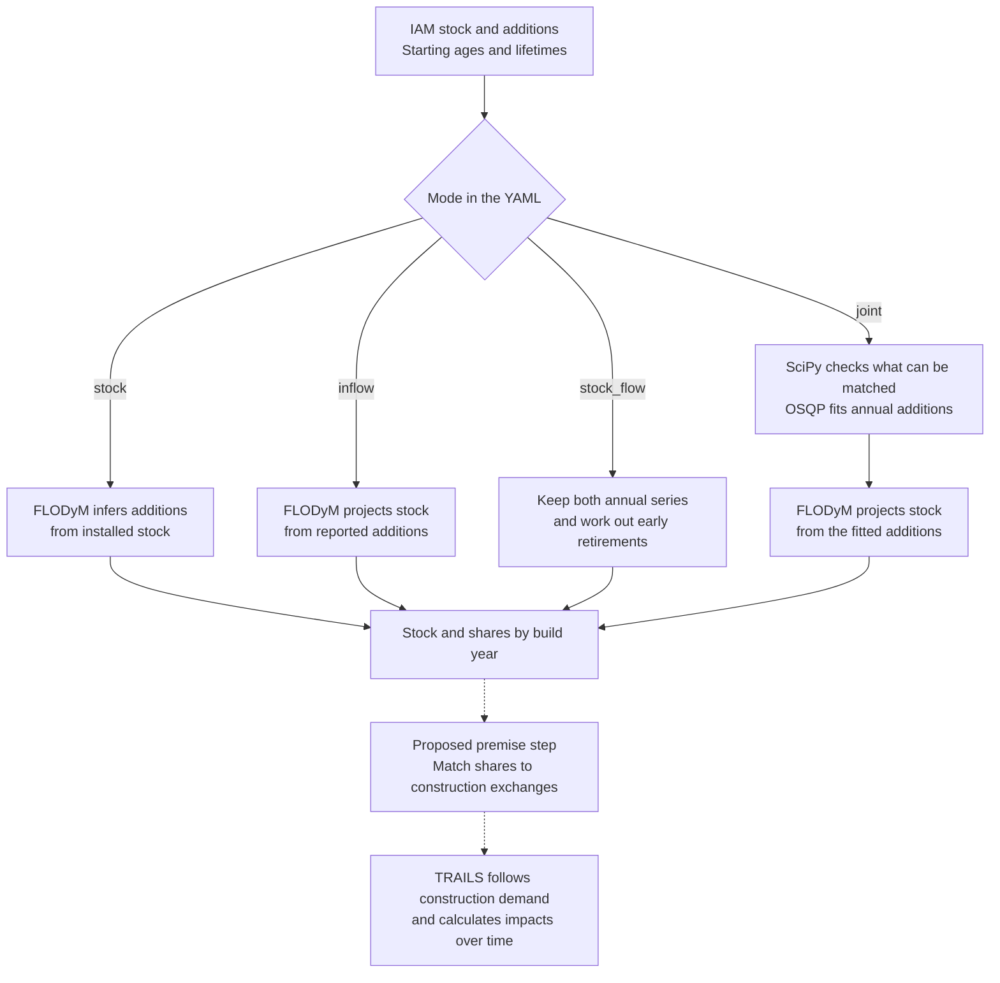

# iam-prep-for-premise

Prepares IAM scenario files for [premise] and reconstructs the build-year mix of
assets for dynamic LCA with [TRAILS].

For example, the tool can estimate how much of the solar capacity still
operating in 2040 was built in 2025.

The estimates are preliminary. They use reported capacity and additions,
equipment lifetimes, and information about the assets already in use at the
start. The same workflow is designed for integrated assessment models (IAMs)
used with `premise`, including [REMIND], [IMAGE], and [MESSAGE]. For each asset,
choose the input rows and specify how long the assets last.

## Start here

- The method, inputs, outputs, and limitations. [Stock-vintage guide](docs/stock-vintages.md)
- The short guides and research notes. [Documentation list](docs/README.md)
- The files to use for a first run. [Examples](examples/README.md)
- The Python modules and functions. [Python API](docs/api.rst)

## Installation

[Python] 3.10 or newer is required. Install the package with [pip].

```console
python -m venv .venv
source .venv/bin/activate
python -m pip install -e '.[stocks]'
```

Python imports use `iam_preprocessor`. Existing scripts can also use the
`iam-preprocessor` command.

## Run the workflow

### 1. Prepare the scenario file

**For a scenario CSV for premise**, run `prepare` with its default filter. It
puts the table in a standard format and keeps the rows selected for premise.

```console
iam-prep-for-premise prepare scenario.xlsx -o output/premise
```

This writes `output/premise/scenario_filtered.csv` and
`output/premise/scenario_report.json`. If you only need the scenario CSV, stop
here.

**To build stock vintages**, use `--no-filter` to keep the stock and addition
rows needed in steps 2 and 3.

```console
iam-prep-for-premise prepare scenario.xlsx -o output/input --no-filter
```

This writes `output/input/scenario_processed.csv` and
`output/input/scenario_report.json`. Use that CSV in steps 2 and 3. If you
already have a CSV, MIF, or Excel file with one model and scenario, one column
per year, and all the required rows, you can start at step 2 with that file.

For a file with several scenarios, use `stock-inventory` to find the exact
labels, then add `--scenario "Scenario label"` to `prepare`. Add
`--model "Model label"` if the scenario name occurs under more than one model.
See the [command-line guide](docs/usage.rst) for optional corrections to files
from specific models.

### 2. Choose the rows and assumptions for each asset

#### Find the variables in your scenario

```console
iam-prep-for-premise stock-inventory output/input/scenario_processed.csv \
  -o stock-inventory.csv
```

`stock-inventory` reads the scenario CSV from step 1 and creates
`stock-inventory.csv`. Open this list to look up the exact variable names and
units available in each region. The scenario CSV supplies the values for each
year when you run the calculation in step 3.

#### Copy and edit the settings template

For REMIND, start with the [filled-in REMIND mapping](examples/stock-mapping-remind.yaml).
It covers 53 asset groups, including vehicles, electricity, heat, and fuel
production. It uses the REMIND 3.5.2 variable names and the 2005–2100 run
settings. Check the names and units in your export and edit the mapping if
some assets are missing or reported differently.

```console
cp examples/stock-mapping-remind.yaml stock-mapping.yaml
```

For other IAMs, copy the [generic template](examples/stock-mapping.yaml) to
`stock-mapping.yaml`. For each asset, copy the installed stock variable name
and unit from `stock-inventory.csv` into `stock`. Do the same for the additions
variable under `inflow`. Use this file to set the lifetime, starting age mix,
and calculation mode for either template.

#### Generate the settings for this scenario

```console
iam-prep-for-premise stock-config output/input/scenario_processed.csv \
  --mapping stock-mapping.yaml -o stocks.yaml
```

`stock-config` reads your edited `stock-mapping.yaml` and the scenario CSV.
It fills in the model, scenario, and years, applies your settings to every
region, and checks that the chosen rows are present. If a required row is
missing, the command tells you which region and variable need attention.

The result is `stocks.yaml`, the settings file you pass to `stock-vintages`
in step 3. To change your choices, edit `stock-mapping.yaml` and rerun
`stock-config` with `--overwrite`.

### 3. Calculate and save stock by build year

```console
iam-prep-for-premise stock-vintages output/input/scenario_processed.csv \
  --config stocks.yaml -o output/stocks
```

The command reads the scenario file and writes the results separately.
The scenario keeps its reported year columns.

```text
output/stocks/
  scenario_processed_stock_vintages_report.json
  scenario_processed_stock_vintages_v2/
    vintages.parquet
    datapackage.json
    validation.json
```

- Each row of the **Parquet table** gives a region, asset, year in use, build
  year, and result type. The package also has a file list and a summary of the
  stock and share checks.
- The **run report** records the input and settings used. The reports flag
  failed checks and any changes joint mode made to reported additions. A
  successful run has a short validation summary. Add `--detailed-report` to
  see the results of each check by asset and region.

The proposed handoff gives premise the IAM scenario on its reported year grid
and supplies the annual build-year shares in a separate file. How premise will
match those shares to construction exchanges is still open.

## How the stock calculation works

Both templates use `mode: stock`. In stock mode, [FLODyM] calculates how much
needs to be built each year to reach the installed stock after retirements.
The reported additions provide a comparison. To try another mode, edit the
asset settings in the YAML.



`joint` is optional and is useful when the IAM reports stock and additions
at intervals. [SciPy] checks whether both can be matched given the starting
stock and retirement assumptions. [OSQP] then chooses a smooth series of annual
additions that matches the reported stock levels. It also matches the reported
additions whenever possible. This repo runs the fit and passes the fitted
additions to FLODyM, which then makes an additions-driven projection.

If the two series cannot both be matched, `annualisation.inflow_constraints`
sets what happens. With `strict`, the run stops. With `penalized`, the fit
keeps the reported stock levels and the run report shows any differences in
additions. See the
[joint fit guide](docs/joint-stock-annualisation.md) for the settings.

In stock-driven runs, normal retirements can leave more capacity than the IAM
reports. Jakob Dürrwächter's FLODyM changes let the model retire some of that
capacity early, for example by increasing the retirement risk for that year.
The installation uses that FLODyM revision. [FLODyM PR #261](https://github.com/pik-piam/flodym/pull/261)

## How the code is divided

| Module | Responsibility |
| --- | --- |
| `stock_workflow.py` | List variables and check the selected rows against the scenario. |
| `stock_config.py` | Check the YAML settings and find the files they refer to. |
| `vintage_inputs.py` | Read the selected rows and fill in years between reported values. |
| `vintage_reconstruction.py` | Estimate one asset's build-year groups and their shares. |
| `stock_model.py` and `flodym_stock.py` | Work out how much stock survives, is added, or retires. |
| `stock_annualisation.py` | Fit annual additions to reported stock and addition data. |
| `stock_vintages.py` and `stock_package.py` | Check and write the results for all selected assets. |

Every IAM uses the same YAML format for the stock calculation. Optional code
that corrects input files lives under `adapters/`.

## Tests and documentation

Use [Ruff] for linting and formatting, [pytest] for tests, and [Sphinx] to build
the documentation.

```console
ruff check src tests examples
ruff format --check src tests examples
pytest
sphinx-build -W -b html docs docs/_build/html
```

Tests use small made-up datasets. The repository excludes private input files,
generated results, and encryption keys. Use `--overwrite` to replace existing
outputs.

## Authors

- Romain Sacchi (PSI) [@romainsacchi](https://github.com/romainsacchi)
- Jakob Dürrwächter (PIK) [@JakobBD](https://github.com/JakobBD)
- David Bantje (PIK) [@dbantje](https://github.com/dbantje)

## License

The project uses the BSD 3-Clause License.

[premise]: https://github.com/polca/premise
[TRAILS]: https://trails.readthedocs.io/en/latest/index.html
[REMIND]: https://www.pik-potsdam.de/en/institute/departments/transformation-pathways/models/remind
[IMAGE]: https://www.pbl.nl/en/image/about
[MESSAGE]: https://docs.messageix.org/en/stable/
[Python]: https://www.python.org/
[pip]: https://pip.pypa.io/en/stable/
[FLODyM]: https://github.com/pik-piam/flodym
[SciPy]: https://scipy.org/
[OSQP]: https://osqp.org/
[Ruff]: https://docs.astral.sh/ruff/
[pytest]: https://docs.pytest.org/en/stable/
[Sphinx]: https://www.sphinx-doc.org/en/master/
